<p align="center">
  
</p>

<div align="center">

```bash
yooodleee@github:~$ ls -la

drwxr-xr-x  backend/
drwxr-xr-x  systems/
drwxr-xr-x  devops/
drwxr-xr-x  ai/
drwxr-xr-x  experiments/

-rw-r--r--  README.md
-rw-r--r--  philosophy
-rwxr-xr-x  build.sh
```

</div>

---

### `$ cat philosophy`

```text
understand > implement > measure > iterate

observe before guessing
reproduce before fixing
automate before repeating
document the why
```

---

### `$ ls -la ~/toolchain`

<table>
  <thead>
    <tr>
      <th align="left"><code>mode</code></th>
      <th align="right"><code>n</code></th>
      <th align="left"><code>dir</code></th>
      <th align="left"><code>entries</code></th>
    </tr>
  </thead>
  <tbody>
    <tr>
      <td><code>drwxr-xr-x</code></td>
      <td align="right"><code>5</code></td>
      <td><code>languages/</code></td>
      <td>
        
        
        
        
        
      </td>
    </tr>
    <tr>
      <td><code>drwxr-xr-x</code></td>
      <td align="right"><code>6</code></td>
      <td><code>editors/</code></td>
      <td>
        
        
        
        
        
        
      </td>
    </tr>
    <tr>
      <td><code>drwxr-xr-x</code></td>
      <td align="right"><code>5</code></td>
      <td><code>shell/</code></td>
      <td>
        
        
        
        
        
      </td>
    </tr>
    <tr>
      <td><code>drwxr-xr-x</code></td>
      <td align="right"><code>4</code></td>
      <td><code>backend/</code></td>
      <td>
        
        
        
        
      </td>
    </tr>
    <tr>
      <td><code>drwxr-xr-x</code></td>
      <td align="right"><code>6</code></td>
      <td><code>data/</code></td>
      <td>
        
        
        
        
        
        
      </td>
    </tr>
    <tr>
      <td><code>drwxr-xr-x</code></td>
      <td align="right"><code>5</code></td>
      <td><code>frontend/</code></td>
      <td>
        
        
        
        
        
      </td>
    </tr>
    <tr>
      <td><code>drwxr-xr-x</code></td>
      <td align="right"><code>8</code></td>
      <td><code>infrastructure/</code></td>
      <td>
        
        
        
        
        
        
        
        
      </td>
    </tr>
    <tr>
      <td><code>drwxr-xr-x</code></td>
      <td align="right"><code>4</code></td>
      <td><code>delivery/</code></td>
      <td>
        
        
        
        
      </td>
    </tr>
    <tr>
      <td><code>drwxr-xr-x</code></td>
      <td align="right"><code>5</code></td>
      <td><code>observability/</code></td>
      <td>
        
        
        
        
        
      </td>
    </tr>
    <tr>
      <td><code>drwxr-xr-x</code></td>
      <td align="right"><code>4</code></td>
      <td><code>collaboration/</code></td>
      <td>
        
        
        
        
      </td>
    </tr>
    <tr>
      <td><code>drwxr-xr-x</code></td>
      <td align="right"><code>3</code></td>
      <td><code>os/</code></td>
      <td>
        
        
        
      </td>
    </tr>
  </tbody>
</table>

```text
11 directories, 55 entries
```

---

### `$ ./build.sh`

```text
[+] design
[+] build
[+] test
[+] deploy
[+] observe
[+] debug
[+] repeat

0 errors.
∞ iterations remaining.
```

---

### `$ git log --graph --all`

<p align="center">
  <picture>
    <source media="(prefers-color-scheme: dark)" srcset="https://raw.githubusercontent.com/yooodleee/yooodleee/output/github-contribution-grid-snake-dark.svg"/>
    <source media="(prefers-color-scheme: light)" srcset="https://raw.githubusercontent.com/yooodleee/yooodleee/output/github-contribution-grid-snake.svg"/>
    
  </picture>
</p>

---

<div align="center">

```bash
yooodleee@github:~$ echo $STATUS

BUILDING...
```

</div>
